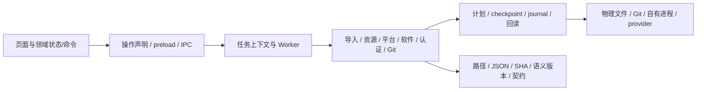
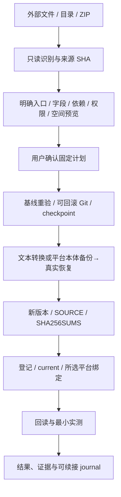

# 架构管理台 0.5.0：本体接入与模块结构

管理台是每位使用者本机的一套架构工作区管理程序，使用 Electron、React、Node IPC 和平台 Python/provider。它维护已有三仓和平台配置，不引入中心服务器、另一个共享仓或第二套运行引擎。架构版本、管理台版本、引擎/连接器版本分别管理；管理台 0.5.0 不意味着所有平台已切换或自动取得新能力。

## 模块和调用方向

| 目录 | 职责 |
|---|---|
| src/app | 统一操作声明、查询/命令边界、任务工作区归属；preload 从声明生成 |
| src/core | 路径和目录边界、BOM/JSON、文件 SHA、平台发现；外部本体按物理文件读取 |
| src/domains/intake | 外部文件/目录/ZIP 清单、来源哈希、文本/源码转换、版本发布、安置、恢复及撤销 |
| src/domains/resources | 契约、精确依赖、语义化版本、登记/current 和双向封条验证 |
| src/domains/certification | 内容/环境/规则指纹、选格、带来源 SHA 的证据沿用、失败续检 |
| src/domains/platforms / software | 平台运行时绑定、软件动作/MCP 配置、实际发现、凭据引用及会话 |
| src/infrastructure / transactions | 异步 Git、Worker、自有子进程树、取消、事务内核及 compare-before-restore |
| src/renderer/features | 工作区、资源、接入、平台、软件、文档、Git 和计划的状态/命令；App 只组合 |
| src/renderer/shared | 计划预览、任务反馈、工作区/对象请求守卫、schema 表单和通用显示 |
| src/runtime | 解包的 Python/provider 辅助程序，包含标准架构 CLI/MCP 服务和原生 MCP 协议辅助 |

旧公开 API 暂作兼容出口；同一个业务规则继续调用共同校验和执行器。异步返回必须匹配本次工作区和对象，失效上下文不能继续派发 IPC，也不能覆盖新页面。长任务有进度、停止与最终 settlement。

## 从本体到已发布资源

agent、skill、tool 生成可冻结的文本/源码定义；skill 属 tool 的技能目录。软件仓只发布配方、schema、连接声明及真实快照。本体、环境、凭据和状态按 BP-1 第③路落在所属平台 runtime；平台备份归 inbox/backup。恢复副本最终成为本体，共两份完整数据，不再为了演练瞬时保留第三份。流式复制按块出进度，可比对已复制前缀后继续。

更新建立新语义化版本；仅发布与采用默认分开，在途 run 继续原锁。重复确认校验已有 journal/回执，不重复安装或盲目起第二份 GUI。恢复先比较本轮写出内容，外部新改保留并报冲突。撤销登记恢复自己负责的旧指针/配置；释放版、本体与备份保留。

## 平台与软件能力的边界

平台安置、标准架构服务回环、导入客户端随机挑战、厂商原生注册、能力地板和首检认证分列。维护链由管理台运行，不要求 AI 会话补 JSON；但登录、许可、系统安装/UAC，以及厂商缺失的工具接口仍需对应真实操作/适配。BP-2 完成仍要求各平台自己出证并达 0 declaredAbsent，不能互抄。

软件通过三类入口接入：通用 CLI 参数映射、GUI provider 会话、已存在 MCP 的实际发现。一般 CLI 无需独写 MCP；GUI 会话不凭启动成功声明内部功能自动化。MCP 使用 stdio、旧 SSE 或 Streamable HTTP，工具 schema/程序字节/权限绑定到快照；实际调用前重验漂移。未支持协议、OAuth、特殊证书或专用连接器缺失保持明确 pending。

凭据走 reference 通道，本平台 Windows provider 负责 WinCred/DPAPI，加密备份真实恢复验证。值只在内存、系统凭据库和加密本平台备份中处理；计划、审计、证据和三仓没有实值。当前用户绑定的加密备份不宣称可在另一用户或机器直接解密。

新发布 software/_connector 1.0.8 提供原生 MCP 调用；此前 1.0.7 字节及共享 current 保持不变。明确确认 MCP 绑定计划才修改所选平台配置。

## 最小量认证和 Git

平台检查统一先 conform，再按配置、内容、环境/provider 和规则哈希选变化/未完成格。完整首检/大版本锚点保留，沿用格带原报告 SHA，缓存与本次实测分列。无完整有效旧证据时，零行不能通过。

新发布 wf-runner 0.12.2、repo-lint 0.6.5 和 architecture-ops 1.5.2 提供正式单进程 prepare→next→stop 接口。两代表格各三次的中位耗时为旧路径 57.4%/73.8%，启动次数 3→1；并非全平台已采纳，也不是首次采用新规则时免除所有受影响格。

Git 使用真实 -z 路径、显式文件列表、保留无关暂存、变更范围凭据/本体/大文件扫描、正常推送。历史 bundle/工作树备份与 HEAD 文件导出分开；真实恢复后才记备份有效。根仓治理与管理台源仓分别提交，不把私有维护证据、本体和凭据上传。

## 验证和范围

统一 P1–P18 原判据收口：最终 conform 177 项，176 PASS / 1 SKIP / 0 FAIL；唯一未配置 WSL 后代取消未声称已测。实际 EXE 运行代表导入、更新、CLI/MCP 功能、真实 GUI 窗口、平台挑战、复制中取消续接和撤销。双包内 app.asar 与最终源码逐文件回读一致，辅助 runtime 文件在 app.asar.unpacked。

本轮原生 Windows 自动化 API 不可用；系统弹窗人工点击未自动验证。EXE 自身 DOM→IPC→Worker→文件/进程/Git 路径是真执行，仅自身确认弹窗由内存测试驱动回答。专用客户端接口、系统登录/UAC 和 GUI 内部业务不冒充通用样例已验证。

后续非阻断问题按执行台账另轮处理，不改本次判据：历史版本身份/来源措辞、依赖审计、第一次新规则指纹开销、展示引用路径、Git 确认目标文案及极早取消时的错误分类。操作细节以同版使用手册为准。
