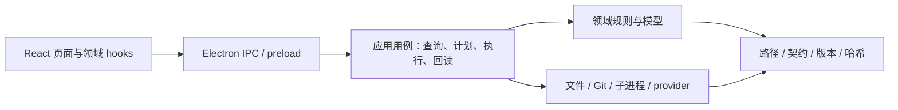

# 管理台统一实施方案：修复、模块化、提速与本体接入

日期：2026-10-03。当前基线：管理台 0.4.1，源仓 `9d3e5b42a6b5a2335e583d94a034c36a7c482d4b`。

**状态：方案已形成，待批准；P1–P18 尚未执行。** 用户要求最后全面排查、模块化和有序化，并由 Codex 决定先提速还是先优化。本轮已完成代码审查、既有测试及隔离复现，详见 [全面排查记录](架构管理台全面排查记录-20261003.md)。本次只维护方案，不改生产代码、配置、软件本体或发行包。

## 1. 顺序裁定

**先修正确性并抽出必要公共模块，再提速，随后补齐本体接入和界面管理。** 不先做整个工程的大重写，不把所有重构完成当作提速前置。

1. P1–P5 处理会导致操作失败、错误入库、错误切版/回读的缺陷，以及直接影响修复的公共边界。
2. P6–P7 统一增量认证并降低重复启动开销。未变化格不重复检查，真正变化不能漏检。
3. P8 交付一个可用的修复与提速补丁，让用户先获得改善。
4. P9–P16 完成“有本体→管理台接入”的共同导入和四类业务界面，进一步按领域整理代码。
5. P17–P18 实际 EXE 验证、文档、发行和入库收口。

原因来自实测：18 条复现中包含未选文件被提交、强推选项被接受为远端、坏备份回读仍通过、损坏版本可切默认、同钉版漏选新资源。提高这几条路径的速度会让问题更快发生。现有 94 项测试的 93 PASS / 1 SKIP 也说明只依靠已有后端测试不能证明界面功能完整。

本方案成为唯一实施顺序；[矩阵提速方案](架构管理台矩阵增量认证与提速方案P表-20261003.md) 和 [本体导入方案](架构管理台本体导入接入方案与P表-20261003.md) 保留为需求/机制附件，旧 P 表不再独立执行，也不形成重复验收要求。2026-09-30 已批准并完成的提速轮不被撤销；这里解决的是本轮新发现的缺陷和新需求。

## 2. 完成后的使用方式

首页入口“添加到架构”，选平台、智能体、工作流/技能或软件；选择本体文件/目录/ZIP，自动识别，必要字段用中文表单补充，查看一页变更和空间预览，再确认接入。格式转换、版本、依赖锁、封条、登记、绑定、最小实测及 Git 都由管理台处理。

更新选择新本体，沿用对象 ID 并发布新版本；可看全文和差异、切默认、停用、撤销本轮。软件页面显示该平台实际绝对路径，能打开位置或经 provider 启动。通用 CLI 和现成 MCP 用表单接入；专用连接器缺失有明确补齐路径，不要求普通软件逐个重写 MCP。

导入成功、已发布、已绑定、可启动、架构可调用、原生客户端已验证分别显示。平台没有任何 CLI/MCP/插件工具接口时，管理台可以登记和启动，但不能凭 EXE 创造接口或显示 BP-2 接入完成。真正的业务输出仍由本体和业务客户端产生，接入测试不假造模型工作结果。

## 3. 使用什么以及模块怎么分

保留 Electron、React、Node、已有 Python 运行时辅助程序、三仓及已有 provider/连接器。继续使用现行 JSON/YAML 契约和固定版本的 repo-lint/platform-conformance；不换框架，不新增共享仓、中心服务器、永久领域环境或另一套运行引擎。

建议目录（都在已登记的 architecture-manager 内；名称在 P1 冻结）：

```text
src/
  main.mjs                    # 兼容 Electron 启动入口，保持薄
  preload.cjs                 # 明确允许的 IPC 桥，不放业务判断
  core/                       # 路径、JSON/编码、哈希、语义化版本、错误与契约
  app/                        # 查询、计划、执行、回读的用例与操作声明
  domains/
    workspace/                # 工作区会话与绑定
    intake/                   # 来源识别、转换、暂存和导入计划
    resources/                # manifest、依赖、发布、registry、current、引用
    platforms/                # 平台配置、环境、客户端、治理接入
    certification/            # 指纹、影响范围、证据、执行、合并和续检
    software/                 # 本体、配方、CLI/MCP、健康检查、会话与恢复
    git/                      # 状态、显式提交、远端、快照/备份和回滚
    governance/               # 计划、缺陷、要求文档与文档站
  infrastructure/             # 文件、Git/Node/子进程、审计、checkpoint、备份
  electron/                   # IPC 注册、目录/文件选择、原生确认、应用生命周期
  renderer/
    main.jsx                  # 页面挂载入口
    App.jsx                   # 导航和页面组合
    features/                 # 各业务的组件、hook、控制器与结果呈现
    shared/                   # 向导、预览、进度、错误、分页等通用显示
  runtime/                    # 可解包的 Python/provider 辅助程序，保持现有职责
```

调用方向：



核心规则是单向依赖：领域模型不依赖 React/Electron；查询不运行程序或落盘；文件/Git/provider 的真实副作用只经对应执行用例。旧 app/api.mjs 和公开方法可暂作兼容出口，避免一次改坏全部调用者；不长期保留第二套逻辑。

### 3.1 第一批公共模块

- **路径和读取**：全工程使用同一套 targetPath/inside/编码规则；JSON 接受 UTF-8 BOM，原件哈希按实际字节保存。路径不存在、格式错、越界与来源漂移分别报白话原因。
- **版本与完整性**：一种 semver 比较、一种 manifest/定义身份检查、一种双向封条检查、一种 registry/精确依赖校验；准备、apply、verify 共用，避免某页面只判断 SHA256SUMS 存在。
- **操作声明**：每个操作定义输入、计划 kind、执行器、验证器、是否有副作用、进度及取消策略；由同一声明派生 IPC/preload/界面允许面。补一个操作时不能忘记界面执行白名单或验证分支。
- **认证指纹**：从 platform-check/onboarding-state 抽出独立模块，消除循环；环境/配置/资源/依赖/验证器摘要有明确粒度。
- **任务状态**：jobId、workspaceSession、target、phase、进度、取消、超时、settlement 一处维护；工作区切换后不把旧响应放到新页面。

根 App 的扫描、资源、软件、文档、认证、Git 状态逐步移到对应 features hooks/controller。不是按任意行数把代码切碎，也不建立一个万能管理器。拆模块同时保留可调用的入口和必要验证，单次提交能安全停手。

## 4. 必须先修的业务规则

### 4.1 Git、备份与回滚

状态使用 porcelain -z，不 trim 原始记录；正确处理中文、空格和 rename。提交明确列出的路径，同时检查原暂存区，拒绝或隔离无关 staged 内容，不把用户已有暂存悄悄一起提交，也不清空它。

敏感/本体/大文件扫描以实际要提交的文件与索引字节为准，展开目录；小 EXE、带 NUL 文件不再直接跳过。推送前扫描实际即将外传的改动范围。远端从已配置列表选择，拒绝 --force/--mirror 等选项式值；apply 重验目标，不借 force:false 字段宣称安全。

“HEAD 文件快照导出”与“Git 历史备份”明确分开。前者可归 archive，后者按平台维护归属入 backup，用 Git bundle/必要工作树内容及摘要登记，不让用户把只含 HEAD 的 ZIP 当成全仓回滚。备份回读复算内容摘要并真实恢复一次；坏 ZIP、少文件、缺清单必须失败。回滚显示源/目标 commit、影响路径、当前未提交内容及冲突处理，不强推、不静默 reset 用户工作。

### 4.2 发布、登记与指针

发布前验证现行契约和精确依赖，不接受只有哈希正确的空工作流/错误 schema。新 ID 不需要预先存在 current；创建对象与发布新版本分别可用。升级同步处理 manifest、workflow 定义的身份字段，原文变更显示差异。

registry 修改不能只检查合法 JSON；要验证实际三仓结构、ID、启用状态、指针与依赖。指针应用前再次验证目标版本的内容及配对约束，回读验证真正目录和来源摘要。软件发布也检查额外文件；全文查看/编辑通过新版本保存，不改冻结旧字节。

P4 就将现有发布入口接到公共校验，R10/R15 的错误模板或身份不一致候选先明确拒绝，不让它们继续被标为成功；P12 再完成从零创建和正确升级的正向界面。P8 补丁说明需明确这一边界，不宣称所有新资源发布能力已经补齐。

### 4.3 公共事务与真实副作用

统一 journal、checkpoint、基线、apply-before-recheck、回读和 compare-before-restore。中途失败恢复自己写出的字节；如果目标已被外部改动则保留现场并提示冲突，不用旧 checkpoint 强行覆盖。多文件不是天然原子事务，状态逐步落盘并可续跑。

软件健康检查携带 platformId，经该平台真实绑定和连接器解析，不从共享 recipe 读取平台绝对路径；每软件解释器独立解析。任务执行不拼 shell 字符串，不用环境 PATH 中的 python/Node 假装指定解释器。

长操作从同步 execFileSync/同步大复制移到共同异步任务面；Git、克隆、文档构建、软件探测/发布/启动也能显示进度和停止。软件会话由 provider 接管，与短期检查进程树区分；取消只处理本轮所属、尚未移交的进程，不杀用户原有软件。文档构建固定正确 Node 运行方式及真实写入范围，保留 runtime helper 的 ASAR 解包规则。

## 5. 提速策略

先推荐并在界面明确采纳已有 0.12.1 / 0.6.4 性能补丁，不自动替其它平台切生产；原锁仍按旧钉版继续/停止。新平台推荐组合由当前冻结 manifest/依赖配对决定，不能取三个“最新”字符串盲拼。

所有认证入口使用同一判定器：

- 首次平台接入及引擎/契约明确大版本升级完整一次；有效首检覆盖面及哈希保留。
- 普通资源新增/升级且复用已有 Profile：只做点名资源和实际受影响依赖，不逐平台全矩阵重认证。
- 内容/依赖、相关配置/Profile/provider/环境或验证规则改变时重新判断范围；相同引擎摘要不能直接缩为 expert-task。
- 失败/中断只补失败或未完成格；变更或证据损坏不得沿用。本次实测、沿用旧证据、失败、未测明确分列。

新 runner/检查器发布单格批处理接口，每格一次进程走正式 prepare→next→stop，共用导入/初始化，完整性与状态事务照常校验。初版保持按格串行，不默认开高并发；软件保持正式网关路径。所有性能数据分解析、初始化、协议、软件连接和完整性校验，不能把 0.531 秒解析说成完整认证总耗时。

拟议性能判据：每成功工作流/专家格 runner 启动 3→1；两个预先固定代表格分别按原补丁 CLI/候选各测 3 次，同机中位总耗时≤原补丁的 80%。判据批准前固定，未达不能宣称本轮提速完成。不会预先承诺 52 格固定几分钟。

## 6. 四类本体导入的实现

共同 intake 模块负责只读来源识别、源哈希、目录/ZIP 清单、暂存、转换计划、冲突、空间和恢复；选择外部来源后不要求用户先摆成三仓格式。目录联接/符号链接、ZIP 穿越、额外二进制/缓存/凭据按一套规则处理。未知文件内的“执行指令”只是导入内容，不改变管理台行为。

| 类型 | 普通用户需要提供 | 管理台完成 |
|---|---|---|
| agent / skill | 提示词文件、SKILL.md、目录/ZIP或有明确入口的源码项目；表单确认角色和依赖 | 正文保留、manifest/精确锁/catalog、SOURCE、封条、新版本、登记和最小调用 |
| tool | 工作流说明/定义、脚本项目；确认阶段、输入输出、入口和依赖 | 生成合法非空定义/schema、准备所属平台环境、发布和点名验证；选 EXE 时引导归 software |
| platform | 客户端程序/目录或已有 CLI/MCP 配置；必要系统登录/权限操作 | 应用模板、生成自己的配置/环境/provider、注册到真实客户端、实测接线、治理和 Git |
| software | 本体/安装包、程序入口或 MCP 配置；确认动作和必要连接器 | 本体安置/安装结果绑定、通用 CLI/MCP/provider、真实路径/启动、配方/快照、备份恢复和功能验证 |

环境归属明确选 BP-1 第③条：所属平台 runtime；共享仓只放可冻结文本/源码/配方，真实本体、生成依赖、凭据和状态不入仓。普通提示词不触发无关环境安装。来源默认保留；本体安置空间含恢复演练峰值。CLI 版本询问成功不证明其它功能；MCP 只冻结实际发现和已明确权限的能力；无接口的 GUI 先发布真实会话能力，不编造操作适配。

## 7. 检查方式和风险控制

保留 Node 原生测试和已发布判据，只增加能捕获本报告真实失败的必要用例，合并成一条 `npm run conform` 输出 digest：静态未定义变量、模块边界、关键回调、真实领域事务、变化范围/取消/恢复、冻结版本和候选包回读。不是每个函数再写一个模仿实现的测试，也不追加逐平台全矩阵。

开发检查采用锁定版本的 ESLint，启用 no-undef 等直接捕获 R01/R02 的规则；该规则专门检测未声明变量导致的潜在 ReferenceError。[官方 no-undef 说明](https://eslint.org/docs/latest/rules/no-undef)。版本在 P1 根据现有构建 Node 和依赖锁冻结；不在本次排查安装新依赖。保持必要的层间导入/循环检查，查询面不能导出落盘执行函数。

本机 Node 24.18.0 不代表 Node 18 也能构建当前依赖；更新开发运行时要求和 doctor，使其符合锁定 Vite/插件。开发工具不要求最终用户操作控制台。

实际 EXE 验收只走代表用户链：选择外部本体→预览→执行→结果/位置/调用→更新→一次中断恢复，外加发布/差异按钮真实可点。已在后端满足的相同判据不再另加全矩阵。系统锁屏、登录、UAC、软件许可及重启如实进入待用户状态，不能代答或刷绿。

## 8. 有序 P 表

每 P 约 2–3 小时墙钟，三个可安全停手子块；工程估计 **36–54 小时**，不是固定交付时刻。两次可用交付点分别为 P8 与 P18。号段/来源/判据在 P1 冻结，新发现非阻断问题只登记，不在执行期追加门槛。

| P | 时长 | 子块 | 可停手产物 | 预定判据 |
|---|---|---|---|---|
| P1 基线与回滚 | 2–3 h | ① 固定来源、支持格式和两阶段版本号段；② 固定必要复现/性能样例、契约及模块边界；③ 提交两仓回滚点、登记备份与开发运行时 | 基线/判据/锚点 | 不覆盖旧释放版；范围与验收先定；破坏前入库 |
| P2 API 和界面直接错误 | 2–3 h | ① 分清查询/计划/执行/回读与统一操作声明；② 修复 R01/R02 并用真实回调验证；③ 先抽工作区/任务/计划控制层，旧 API 兼容 | 操作面、回调与分层入口 | 未定义变量不再可构建发布；四类方法清楚；相关按钮真的到达 IPC |
| P3 Git 与备份 | 2–3 h | ① 修 -z 路径/目录及索引扫描；② 约束提交暂存和真实远端、扫描外传范围；③ 快照/历史备份区分、摘要和恢复回读 | Git 计划/执行/恢复证据 | R03–R07/R18 对应负例被拒或正确解析；坏备份失败；无关索引保留；无强推 |
| P4 资源校验与登记 | 2–3 h | ① JSON/BOM、semver、路径共用；② 版本身份/schema/精确依赖/双向完整性；③ registry/current apply/verify 与现有发布入口用同一校验 | 资源模型和校验器 | R08/R11/R13/R14/R16 闭合；R10/R15 的非法候选明确拒绝，正向完善留 P12；非法登记/损坏目录不能被采用或回读通过 |
| P5 事务及长任务 | 2–3 h | ① 整理 journal/checkpoint/compare-before-restore；② 异步 Git/文档/软件/克隆与生命周期；③ 修平台健康绑定、Node 方式、任务关联和进度 settlement | 公共执行器、领域事务、恢复报告 | R17/S02/S04/S05/S06 对应判据；恢复不覆盖外部新改；取消不留本轮子树，不杀原有软件 |
| P6 认证范围统一 | 2–3 h | ① 抽指纹/证据以消除循环；② 统一所有入口影响判定和首检迁移；③ 同钉版变更、Profile/provider 与坏证据负例 | 范围预览、带来源合并报告 | R12/S01 闭合；只测真正受影响格；零行不能 PASS；证据不互抄 |
| P7 认证批处理与计时 | 2–3 h | ① 界面推荐/明确采纳性能配对；② 新释放版每格一次进程的正式接口；③ 两代表格三次比较、关键错误和真取消 | 新候选、阶段耗时、对比 | 启动 3→1、结果/分类等价、中位耗时≤原补丁 CLI 的 80%；不削完整性 |
| P8 修复提速补丁交付 | 2–3 h | ① 一条 conform 回读、必要 GUI 修复入口；② 新双包/哈希/操作说明；③ 两仓扫描/提交/推送与发行读回 | 首个可用补丁 | P1–P7 判据成立，本轮路径干净/远端一致；明确尚未补齐的本体功能，不冒充完整新版本 |
| P9 本体识别与预览 | 2–3 h | ① 外部文件/目录/ZIP 识别；② 源哈希、转换和排除/空间预览；③ 链接/穿越/编码/来源改变负例 | intake 模型与来源清单 | 本体无需预放三仓；原件保留；危险路径/源变更拒绝；大扫描有进度 |
| P10 共同导入与恢复 | 2–3 h | ① 同 ID 更新、冲突与重复计划；② 暂存/发布/登记/绑定组合事务；③ 中断续跑、撤销及备份真实恢复 | 导入 journal/计划/回读 | 原件与旧版本不改；重复确认不重复安装/启动；失败在安全点停手 |
| P11 agent / skill | 2–3 h | ① 正文/元数据/依赖表单；② manifest/锁/catalog/版本和登记；③ 全文查看编辑、更新和最小调用 | 专家/技能样例 | 无 current 提示词可接入；原文不丢；依赖精确钉版；新旧版本独立 |
| P12 tool 与发布完善 | 2–3 h | ① 说明/定义/脚本及阶段表单；② 修 R10/R15 新 ID、合法模板和升级身份；③ 解析、发布、采用及点名验证 | 可调用工作流与新发布面 | 无需手写架构 JSON/YAML；非空合法定义；程序本体归软件；未确认业务不执行 |
| P13 平台本体 | 2–3 h | ① 程序/目录/客户端配置识别；② 模板/环境/provider/原生注册/治理；③ 实际客户端挑战和缺接口/登录状态 | 真入口回执与接入记录 | 管理台完成维护链，无 AI 维护会话；桥接回环不冒充原生接通；BP-2 地板真实满足才完成 |
| P14 软件 CLI / GUI | 2–3 h | ① 安置/安装结果/真路径；② CLI 动作参数和 provider 会话；③ 配方更新、绑定、只读实测/恢复 | 软件样例及操作界面 | 通用软件无需独写 MCP；启动、版本、具体功能分列；安装包不冒充已安装 |
| P15 既有 MCP 与专用适配 | 2–3 h | ① 配置导入/连接/真实能力；② schema/权限/凭据引用/快照；③ 断连、漂移和缺连接器提示 | MCP 样例、真实快照 | 不编造未发现功能或安全权限；凭据不出库；专用适配缺失有明确路径 |
| P16 界面与治理整理 | 2–3 h | ① 完成各 features 状态/命令拆分，App 只组合；② 统一预览/结果/分页/错误与任务关联；③ 修 R09 按表头解析 P 表、实际版本和新手说明 | 领域 UI、计划与帮助 | 四类添加/更新/停用路径可找到；普通和加粗 P 表都可见；不显示过期任务结果 |
| P17 实际 EXE 与恢复 | 2–3 h | ① 四类外部本体代表样例；② 真窗口走导入/位置/调用/更新；③ 一次取消/继续/撤销及证据回读 | GUI 操作与恢复证据 | 不使用控制台/手写配置/AI 维护补步骤；状态真实；无残留半截事务；不增加全矩阵 |
| P18 完整版发行与收口 | 2–3 h | ① 一条 conform、必要最终候选构建读回；② 文档站/README/架构说明、双包/哈希；③ 两仓凭据/本体/大文件扫描、正常推送及四读数 | 完整发行及完成记录 | 原定判据全部满足；本轮 status 为空、远端一致、回滚入库早于破坏；新功能范围如实说明 |

P8 与 P18 的确切版本号在实施前读盘冻结：P8 是现有操作修复和速度交付，P18 才是四类本体接入完整交付，不用同一版本名把两个完成层次混为一谈。发布目录只新增，已有冻结版本一字不改。

每个子块结束保存代码/计划或证据；不留在途 run 或半截写入。机器判据统一回读、增量优先，业务不会为了验收而跑完。新测试平台只在首次接入做一次独立完整矩阵；之后沿用带摘要来源补受影响格。

## 9. 本次提交范围

本轮入库包括全面排查记录、本统一方案和两份旧待实施方案的整合说明；检查源码及隔离探针/伪凭据只在 Codex 私有维护区，未改原软件。

源码仍为排查基线；没有把 P1–P18 报成完成。工作区已有 dsh 配置变化与其它平台未跟踪内容保持原样，不计入本轮 status 或提交。精确 HEAD、任务路径 status、远端和入库时间在 codex/runtime/maintenance/20261003-manager-full-review/publication-readback.json；本轮无破坏动作。
