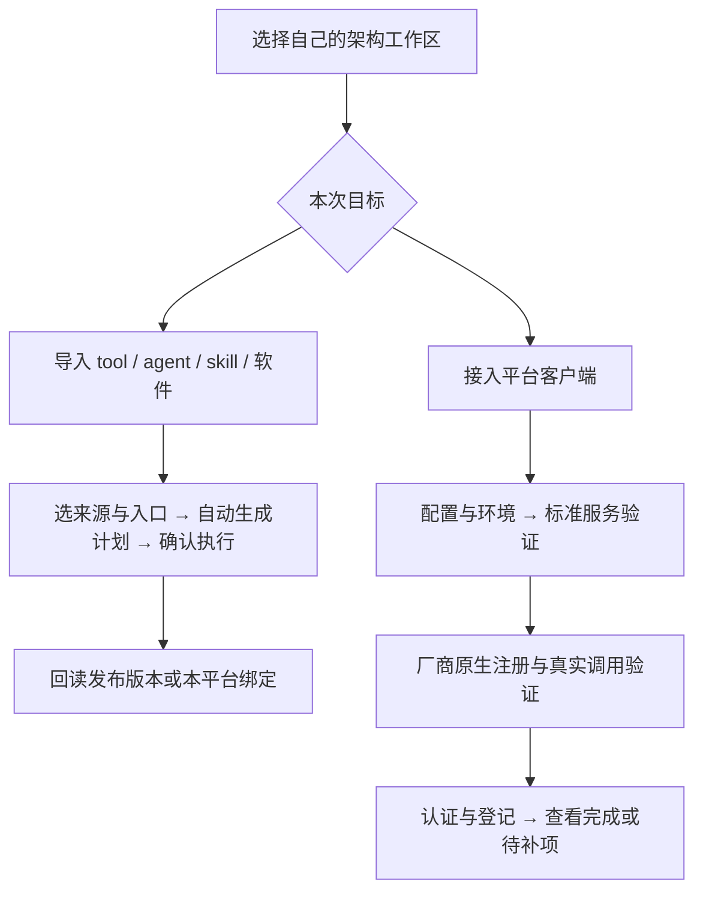

# 架构管理台操作手册（0.7.0）

适用版本：**Architecture Manager 0.7.0 阶段版**。核对日期：2026-10-08。本手册按这一版实际界面编写。按钮找不到时，先看窗口左上角版本，再确认选择了架构根目录。

报错时转到 [报错排查与恢复手册](架构管理台报错排查手册-20261008.md)。0.7.0 可以管理本体导入、三仓资源和平台独立选版；**六个平台的厂商原生全自动接入还没有全部完成**。安装标准架构服务与厂商客户端真正调用三仓是两层验证。

## 1. 第一次打开：选对工作区

1. 打开 `architecture-manager/release/Architecture-Manager-0.7.0-portable-x64.exe`。需要安装时使用同版 `setup-x64.exe`。本机发行目录保留 0.7.0 和用于回退的 0.6.0。
2. 点击右上角 **选择工作区**。本机选择 `E:\ai`；其他人选择自己的架构副本根目录。不要选 `tool`、某个平台或管理台源码子目录。
3. 核对“当前工作区”一行，等“扫描中…”结束。工作区选择会记忆；切换工作区会清空旧计划和待提交凭据。
4. 全新用户可在未选择工作区时，用首次页面的克隆入口创建自己的架构副本。GitHub 账户登录、程序许可和系统组件安装由本人完成。
5. 每个写入操作先生成“计划预览”，核对目标、所属平台、版本和文件，再点 **确认并执行**。单纯识别、预览和刷新不会完成接入。

使用 EXE 无需先安装开发用 Node/npm。运行架构脚本仍需要兼容的 Python 和所需隔离后端；软件还需要自己的本体、解释器、服务及许可。

### 常用入口在哪里

| 顶部栏目 | 用来做什么 |
|---|---|
| 仪表盘 | 看总体读数、计划中心和 P 表进度 |
| 导入本体 | 从文件、目录或 ZIP 添加/更新 tool、agent、skill、平台客户端及软件 |
| 平台与接入 | 配置平台、准备环境、安装服务、原生注册、认证、续接和暂缓 |
| 资源 | 看完整正文、发布新版本、平台独立选版、共享默认及启停登记 |
| 软件 | 看所属平台的实际路径，健康检查、功能调用、启动/存活/关闭会话 |
| 文档 | 编辑说明、P 表、更新日志和顶层要求 |
| 治理 | 维护缺陷登记和状态 |
| 仓库 | 提交、推送、分支、标签、历史备份、快照和 revert 回滚 |
| 运行 / 审计 | 查看业务运行和管理操作记录 |
| inbox / 安全/帮助 | 查看隔离区及操作边界；不自动清空隔离区 |

## 2. 先分清：你想接入什么

| 手里有什么 | 去哪里 | 结果放哪里 |
|---|---|---|
| 智能体提示词、`prompt.md` 或定义包 | 导入本体 → 智能体（agent） | agent 共享仓中的新冻结版本 |
| 工作流说明、`workflow.yaml` 或脚本项目 | 导入本体 → 工具／工作流（tool） | tool 共享仓中的新冻结版本 |
| `SKILL.md` 或技能包 | 导入本体 → 技能（skill） | 架构现有技能目录与版本，不另建第四共享仓 |
| 软件程序、安装目录或 MCP 配置 | 导入本体 → 软件／现成 MCP | software 仓放配方；本体和凭据归所选平台 |
| 平台客户端 EXE/完整目录 | 先导入本体 → 平台客户端，再平台与接入 | 平台本体、配置、独立环境和接入证据 |

三仓放可共享的冻结文本、定义和配方。解释器、软件本体、凭据和运行结果放平台自己的 runtime；不是把整个安装目录上传到三仓。



## 3. 添加或更新 tool、agent、skill

### 3.1 从文件或文件夹添加

1. 打开 **导入本体**，选择类型和**所属平台**。所属平台决定暂存、操作证据和运行环境归属；发布的文本仍可共享。
2. 用 **选择文件／ZIP** 或 **选择文件夹** 指定来源。优先选择内容完整的目录；ZIP 文件名和正文用 UTF-8。
3. 点 **识别并预览来源**，核对拟纳入与排除文件、来源指纹、空间估计。原件会保留。
4. 在 **确认正文／程序入口** 查看自动选择的入口；多个候选时选对正文或定义。`manifest.prompt`、`manifest.entry`、唯一标准正文可用于识别。
5. 点 **自动生成接入计划**，检查 ID、显示名称、新版本、完整正文、主工作流和精确依赖。
6. 有歧义或缺必要字段时，使用下方类型表单补全，再生成计划。agent 必须选择主工作流，并把它列入精确依赖。
7. 点 **确认并执行**。完成后去 **资源** 核对 current、可用版本、正文和启用状态；需要时做最小调用检查。

成功判据：新版本已发布且能回读，登记和封条有效。工作流调用检查证明接口可调用，**不等于正文业务已跑完或模型已生成答案**。任意脚本项目的业务阶段、权限和参数无法单凭路径推断；没有定义时要确认生成的标准模板是否适合你的任务。

### 3.2 查看全部内容、编辑和发布新版

1. 打开 **资源**，按 ID/名称筛选，选择要看的资源或技能。
2. 使用资源的内容查看入口，打开完整正文/文件。大型技能包先筛选并翻页，不要靠首页摘要判断正文被删。
3. 编辑内容或重新导入更新来源。更新沿用同一 ID，选择**尚未发布的新版本号**。
4. 检查依赖后预览、确认、回读。版本号使用 `x.y.z`，如 `1.2.3`；已经发布的目录不能覆盖。

### 3.3 停用或移除登记

在 **资源** 找到登记条目，选择停用或移除登记，预览后确认。管理台会检查现行启用资源的真实依赖；被引用时会列出引用来源。

停用不等于删除冻结目录。需要替换时，先更新引用者的新版本并采用它，再处理旧登记。不能通过删文件或修改已发布锁来绕过依赖检查。

## 4. 接入平台：推荐的一键路线

### 4.1 本体已在工作区内

1. 打开 **平台与接入 → 平台接入向导 → 1. 选择平台**。
2. 在“操作对象”选择已有平台。新增平台填 ID、显示名称，勾选 **允许在本工作区创建该平台一级目录**；ID 用 2–31 位小写字母、数字、连字符，以字母开头。
3. “厂商平台本体”可以留空让管理台识别；发现多个程序时用 **选择程序** 指定实际 EXE。安装器不是已安装客户端。
4. 到 **6. 登记与恢复** 填 Git 提交姓名/邮箱（本机未配置时）。这里是提交署名，不是 GitHub 密码。
5. 看顶部 **本次暂缓**；需要全部接入则不勾选暂缓。仅先保存配置时按第 5 节选择。
6. 点 **预览一键接入／继续**。管理台探测兼容解释器及 WSL，预览列出配置、环境、绑定、验证和提交影响。
7. 核对平台与路径，点 **确认并执行**。缺系统设施、软件本体、登录或厂商接口时会停在具体步骤，保留已完成的安全步骤。
8. 在结果里展开 **证据与读数**，看停止原因、待补软件、能力缺口、客户端与原生验证状态；不要只看一个“已配置”徽标。

本体仍在工作区外时，先走 **导入本体 → 平台客户端** 安置完整目录，确认后再回此向导。不要填写其他平台的运行目录或借用其软件/凭据配置。

### 4.2 一键路线停住后的六个页面

| 步骤页 | 可处理的事情 | 关键按钮 |
|---|---|---|
| 1. 选择平台 | 对象、名称、本体、读取现有配置 | 重新读取当前配置（放弃未保存编辑） |
| 2. 完整配置 | 引擎/契约/检查器、Python、高级路径 | 预览并保存完整配置；有推荐时选择这套提速版本 |
| 3. 准备环境 | 解释器、WSL、独立环境、软件本体/provider | 检测解释器与 WSL；准备独立运行环境；保存软件位置与 provider |
| 4. 客户端入口 | 标准服务、厂商原生注册与验证 | 安装标准 CLI 客户端入口；预览注册原生客户端；验证原生三仓调用 |
| 5. 检查与接入 | 能力实测与认证 | 实测所需能力；保存真实能力声明；开始接入／继续检查 |
| 6. 登记与恢复 | 署名、记录、治理及提交 | 查看接入记录与恢复点；提交当前配置／核验接入状态 |

“预览并保存”类按钮先生成计划，仍需确认执行才写入。检测类按钮会直接进行读检查。

架构运行环境需要 **Python 3.10 或更新版**；检测到 Python 文件不等于它能运行。某个软件的解释器按其配方单独选择，例如“软件配方 PPython 解释器”可以不同于平台脚本派发解释器。不要为了消掉软件报错而改所有程序共用的 Python。

### 4.3 标准 CLI 与厂商 GUI 别填反

“JSON CLI 客户端入口”要接收架构 JSON 并返回本次随机挑战和配置/版本摘要。普通 Electron GUI 不会返回这个回执。**厂商 GUI 填“厂商程序”；标准入口优先用安装按钮生成，不把 GUI EXE 填到 JSON CLI 框。**

标准客户端回环通过只说明架构服务通道可用。厂商原生接入还要注册厂商支持的 MCP 配置，并收到真实工具调用及结果；网页登录成功、`MCP connected` 或模型一句“已连接”都不能替代工具回执。

### 4.4 当前六平台原生边界

以下是 2026-10-08 的 0.7.0 阶段记录，实际使用时仍以本平台的新证据为准；不是其他人的安装保证。

| 平台 | 现行能力与待补项 |
|---|---|
| Codex | 原生三仓冻结读取和平台选版读取已验证；旧选择指向不存在版本时须明确修正 |
| WorkBuddy | 认证完成、MCP 连接已测；未取得真实工具回执，原生接入仍待补 |
| Qoder | 工作区 MCP 已注册；打开该平台 `workspaces/architecture-native` 项目加载配置，实际厂商调用待补 |
| ZCode | 工作区 MCP 已注册；打开对应 `workspaces/architecture-native` 项目，实际厂商调用待补 |
| DSH | 实际 GUI 本体可识别，标准服务可准备；厂商原生接口仍待适配 |
| 豆包 | 标准服务可准备；尚未确认可用的自建 MCP 接口，原生接入待补 |

WorkBuddy 的 **允许一次原生 AI 只读验证** 会先询问明确同意，可能消耗厂商额度。需要登录时，在**当前请求新打开的官方页面**完成登录，并保持同一验证进程；旧页面成功不会自动移交给新请求。超时或没有工具回执时查看记录，不反复点登录/验证。

## 5. 暂缓、续接、重建与排除平台

### 5.1 暂时不需要的模块怎么跳过

在向导顶部 **本次暂缓** 勾选：运行环境与能力实测、软件本体绑定、客户端验证、接入认证／首次矩阵或 Git 提交。配置及安全边界不能跳过。

- 暂缓环境会连带暂缓依赖它的 provider、能力、客户端及认证。
- 暂缓软件或客户端会连带暂缓完整认证。
- 预览会列出自动连带的暂缓步骤。确认后可保存独立步骤，结果是 **本轮配置已保存 · 接入未完成**，不是全部通过。
- 后续取消勾选，再预览并继续补齐。不要把缺口改成 true 或删检查项来制造“接入完成”。

### 5.2 改了配置后怎么继续

| 当前情况 | 应点哪个入口 |
|---|---|
| 配置与版本都未变，只是上次停止 | 预览一键接入／继续 |
| 单独更新组件、安装标准入口或保存了软件位置 | 核对当前更改后续接 |
| 运行引擎、契约或检查器版本变了 | 预览重建接入记录 |

续接预览列出旧/新 SHA 和失效步骤，确认后重新验证受影响结果；旧记录留带日期的历史副本。不要手工修改 `automatic.json` 的哈希钉子。**重新读取当前配置（放弃未保存编辑）** 会丢弃尚未保存的表单值，先处理你的编辑。

### 5.3 暂时不显示某个平台

在 **平台接入与视图** 该行点 **排除视图** 并确认。要恢复，勾选 **显示已排除视图的平台**，再点 **加入视图**。

这只改变管理台视图，不卸载本体、不删除目录、不撤销厂商 MCP、不终止运行任务。退役或删除平台是另一项有备份及授权的维护操作。

## 6. 认证速度与结果怎么看

平台行提供 **检查受影响调用** 和 **接入认证（自动选格）**。

- 首次接入、引擎/契约代际升级或缺少有效首检证据时，需要完整矩阵；0.x 引擎的次版本换代也按代际变化处理。
- 有有效基线时，自动比较正文、依赖、相关配置和验证规则，复用未变化的行，只执行受影响/未通过行。快速检查还会执行代表格。
- 能力地板未达到时，完整矩阵不会开始；先补软件、本平台环境或能力探针，不反复重跑矩阵。
- 灰显/“上次检查缓存”是读旧证据，不代表刚执行了新检查。以检查时间、实际选格、复用行和本次结果判断。
- 真正的接入状态要求本平台自己的配置、能力、认证、客户端验证及登记证据有效；暂缓和单格检查不能代替完整首次接入。

首次需要的格数随启用资源和平台钉版变化，不能把历史“52 格”写成每次固定数量。准备环境、恢复备份和首次矩阵都可能较慢；任务面板有进度时等待安全停点，可停止后从记录续接。

## 7. 软件：接入、位置、启动与 MCP

### 7.1 已有软件配方：优先自动匹配

1. **导入本体 → 软件／现成 MCP**，明确所属平台，选实际程序或完整安装目录。
2. 识别并确认入口，点 **自动匹配配方并接入／标准 GUI 会话**。
3. 唯一匹配时，核对复用的软件 ID/配方版本、本体目的地和绑定，再确认。原件保留，本体会经过备份及真实恢复。
4. 打开 **软件**，先选同一“所属平台”，核对实际路径，点 **健康检查**。之后再按具体功能执行一次必要调用。

多个配方匹配时需明确选择；绑定成功、版本询问成功和具体功能成功是三个结论。其他平台有这个软件不代表本平台已经绑定。

### 7.2 未知 CLI / GUI：补明接口

未知 GUI 可以生成标准会话配方；这不会自动启动窗口，也不自动操作窗口内部按钮。未知 CLI 需在下方软件表单声明版本查询、功能动作、参数类型/顺序和影响。按表单顺序完成安置/恢复，再只读询问并预览配方与绑定。

脚本需明确选择自己的 Python、Node 或 Java；依赖同目录 DLL、资源的程序应选完整目录。安装包只会安置/登记，完成真正安装后要重新选择安装后的本体。

普通 CLI 和标准 GUI 会话可以复用通用连接器，**每个软件不必单独写 MCP**。无接口、特殊认证/传输、特殊参数或 GUI 内部自动化才需要额外适配。

### 7.3 如何看路径、打开目录、真正启动

1. **软件 → 所属平台**，每行看 **绝对路径**、**工作区相对配方**和 **入口模板**。
2. **打开位置** 只打开绑定本体所在目录，确认后不会启动软件。`${softwareRoot}` 等模板不能当作直接可执行命令。
3. **查看启动条件** 是只读旧卡片，不能真正启动。要运行，点 **功能参数与会话**。
4. 在出现的功能面板选择动作、填参数和凭据引用，点 **预览调用这个功能**，核对后确认。
5. GUI 会话用 **预览启动 → 确认并执行**；再用 **预览检查存活**。需要结束时 **预览关闭 → 确认并执行**。仅针对管理台登记的本次会话。

“有冻结证据”的动作可预览调用；“待验证”的动作不会因版本查询通过而自动放行。一次启动结果不明时先查存活，不连续点启动。人工打开的现有窗口没有管理台会话 PID 时，不推定它已被接管。

### 7.4 软件本体绑错了或不再需要

在 **平台接入向导 → 3. 准备环境 → 绑定软件本体与平台 provider** 修改对应“程序文件”，保存软件位置与 provider 并确认。清空某项后保存会解除这项绑定，程序文件保留，相关认证如实待补。

有两份配置时，使用顶部 **软件配置来源核对**，选择“迁入缺少项、保留当前差异”或“迁入并采用此文件差异项”，核对具体旧/新值再确认；随后用 **核对当前更改后续接**。

撤销操作可从 **导入本体** 的操作历史，或 **软件 → 最近可撤销的软件操作** 预览。撤销安置与停用配方不同；仍被发布配方使用的本体不能直接撤销，冻结配方目录保留。

### 7.5 导入现成 MCP 和凭据

1. 选 MCP 配置所在完整目录，确认实际 JSON 入口和配置中的服务；需要时选择运行程序。
2. 按 **1. 预览安置／继续** 执行安置，再点 **2. 实际连接并读取工具**。握手/列工具不等于工具功能已执行。
3. 只勾选要发布的工具，逐项核对影响、文件范围和网络范围，点 **3. 预览发布并绑定所选平台** 并确认。
4. 去软件功能面板按实际 schema 填参数，另行确认实际调用。

支持 stdio、旧 SSE、Streamable HTTP；当前支持协议 2024-11-05、2025-03-26、2025-06-18、2025-11-25。其他协议、OAuth、特殊证书等需要适配，不靠关闭校验解决。

需要凭据时，展开 **需要凭据时：准备、保存或恢复本平台引用**，先预览准备凭据提供器并执行，再填 `reference:my-token` 和单独的密码框。凭据值不写进配置/计划，操作后清空输入；配置和调用只填引用。加密备份与 Windows 用户有关，换电脑/用户需重新登录或录入。

## 8. 为某个平台切换 tool/agent 版本

### 8.1 图形界面切版及回退

1. **资源 → 平台独立版本**，先选择平台，再筛选资源 ID。
2. 读清 **共享默认 / 平台选择 / 当前生效** 三个值。
3. 选择已发布的冻结版本，点 **预览本平台切换／回退**，核对平台和版本，确认执行。
4. 回读“当前生效”。点 **恢复跟随共享默认** 会清除平台独立选择，后续任务重新跟随共享 current。

这不会修改其他平台、共享 current、在途 run-lock 或 agent 内部精确 tool-lock。共享默认切换位于下方三仓资源入口，会影响所有跟随者，请辨明作用域。引擎/契约/检查器配对资源使用平台对齐计划，不能单独半切。

### 8.2 直接跟 AI 说

前提是这个厂商客户端已加载新版架构 MCP，能看到并实际调用管理工具。旧 MCP 进程先重新连接或开新会话。

可以说：“把本平台的 agent 某个 ID 切到某个已发布版本”，或“本平台 tool 某个 ID 恢复跟随共享默认”。AI 应先用 `architecture_get_platform_versions` 读取，说明影响，再用 `architecture_set_platform_default` 确认设置；恢复共享默认使用空版本。Codex 旧 `ai_set_platform_default` 也转交同一执行器。

以工具回执及 GUI 回读为准，不以 AI 口头回答为准。原生工具尚未加载/验证的平台，先用 GUI；不能把管理工具名写进聊天就当已经执行。

## 9. 管理计划、说明文档和顶层要求

1. **仪表盘 → 计划中心（按文档表头读取）** 选择 P 表，查看原文状态、子块、产物和判据。
2. 点 **打开全文／更新计划进度** 进入文档编辑，或直接 **文档** 搜索文件名/类型。
3. 打开原文，编辑、查看 Git 差异，点 **生成文档变更计划**，确认执行。
4. 顶层治理文本需勾选额外确认；发现基线变化时重新打开，不用旧正文覆盖别人的修改。
5. 返回计划中心点 **重新解析**；状态来自原文，不会因某个目录存在而自动变成完成。

**治理** 用于缺陷编号、状态和定位；**审计** 看实际管理操作。管理台修改原文不会自动构建 docs-site，更新站点见第 11 节。

## 10. Git、GitHub、备份和回滚

### 10.1 保存与上传

1. **仓库 → 刷新并扫敏感文件**，看工作区、分支、HEAD、upstream 及 ahead/behind。
2. **提交计划（显式路径）**，仅勾选本次架构文本/配置，填写提交说明，生成计划并确认。
3. 回读提交。**推送计划（禁强推）** 选择已经配置的远端，生成并确认。账号认证在自己的 GitHub/系统界面完成。
4. 推送后刷新，核对真实远端；只有本地提交不等于已经上传。

不要提交软件本体、环境、凭据及运行结果；无关暂存文件需先在其原任务中处理，管理台不会替你清空。根仓和 `architecture-manager` 独立源码仓是两个 Git 仓库；提交根仓文档不等于提交了管理台源码。

### 10.2 哪种备份能恢复什么

| 操作 | 覆盖范围 | 使用方式 |
|---|---|---|
| 历史备份计划 | Git 历史及需要的工作树/暂存内容，实际恢复验证 | 选择归属平台和新名称，核对恢复读数 |
| HEAD 快照导出 | 当前提交里的文件 | 不是完整历史，也不包含未提交修改 |
| 软件/环境备份 | 对应平台的本体/环境；凭据另行加密处理 | 看该操作的备份及恢复记录，不能用 Git 文本代替 |
| 回滚计划（revert） | 撤销指定提交，并保留提交历史 | 先处理未提交修改，填完整提交 SHA，预览确认 |

切回旧 tool/agent 用版本选择，不用删除新目录。卸回管理台 EXE 也不会自动回滚平台配置。软件操作撤销、文档 Git revert 和平台接入续接是不同功能，按失败对象选择。

恢复遇到外部新修改时，保留现场，用原操作记录对比；不要把旧备份整包覆盖当前目录。没有真实恢复演练记录的备份不能称已验证。

## 11. 使用这份 HTML 文档及同步原文

文档站首页、顶部导航及“快速开始”都有 **管理台操作手册** 和 **报错排查**。使用搜索框输入错误码，或用浏览器查找全文；右侧目录可跳到具体步骤。

本机维护者在 `docs-site` 目录运行以下命令，普通管理台用户不需要执行它们：

```powershell
cd E:\ai\docs-site
npm run build
npm run conform
npm run serve
```

预览地址为 `http://localhost:3000`，搜索需要静态服务。对外产物使用 `npm run build:shareable`，紧接 `npm run conform -- --profile shareable`；本机全量产物在 `build/internal`，可分享产物在 `build/shareable`。直接双击 HTML 不能当作完整站点服务。

日常改 `versions` 原文或站点 `content`，不要改自动生成的 `docs`、`generated` 或 `build`。本手册与报错手册两档均收录；内部阶段台账只在 internal 收录。

## 12. 出错后从哪里取证

先记住管理台版本、工作区、平台 ID、按钮、错误码、发生时间及是否点了确认。平台自己的接入记录在 `<platform>/runtime/maintenance/manager-onboarding`，检查报告在 `<platform>/runtime/manager-check`；原生记录在该平台 `runtime/maintenance/manager-native`。管理操作和 checkpoint 可从审计页及本机 ArchitectureManager 用户数据目录回读。

展开“证据与读数”“查看检查问题与能力缺口”“查看检查程序的具体错误”。失败定位看 `error`、`previousAttempts` 和具体报告；`currentStep` 只是流程位置。分享报错前去掉凭据原值、Cookie 和用户隐私，只保留错误/步骤/摘要。

本手册依据：0.7.0 的实际渲染面板、错误解释、认证选格实现、[0.7.0 阶段执行记录](管理台0.7.0-自动接入与平台独立选版执行记录-20261008.md)；源码 HEAD 为 `23405a1a7ed59040d5a11faacfa30b2179dea914`。本次只更新文档，不重新验证各平台业务，也不改变平台选版。
